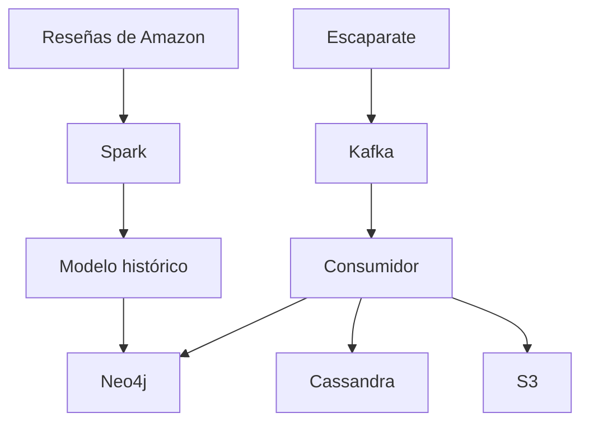

# Andina Sport · Informe técnico

## Recomendaciones de artículos deportivos

¿Qué cinco artículos puede sugerir una tienda cuando una persona explora o compra un artículo deportivo?

### El problema de la tienda

Una persona consulta una colchoneta y quiere descubrir otros equipos de entrenamiento. Andina Sport usa coincidencias entre valoraciones históricas para proponer artículos de su vitrina. El catálogo reúne 20 referencias de fútbol, baloncesto, entrenamiento, running, natación y ciclismo. Las acciones del visitante se registran por sesión.

¿Qué patrón comparten quienes valoran favorablemente dos artículos? ¿Qué método anticipa más valoraciones favorables futuras? ¿Cómo seguir una compra desde el navegador hasta el perfil y el grafo?

### Qué mostró la prueba

Con 500.000 reseñas leídas y 200 perfiles evaluados, Neo4j recuperó al menos un artículo futuro para 2 personas. Spark lo hizo para 0. La baja cobertura de historiales compartidos limita ambos métodos.

La exposición combina una evaluación histórica reproducible y una compra de demostración. En el modo conectado, el laboratorio permite consultar los registros creados por las acciones del visitante. Los importes se expresan en pesos colombianos de práctica.

## Las reseñas que alimentan el modelo

El muestreo conserva las primeras 500.000 reseñas válidas del archivo Sports_and_Outdoors de Amazon Reviews 2023, publicado por McAuley Lab.

| Campo de la fuente | Uso en el proyecto |
| --- | --- |
| user_id | Identifica una cuenta del histórico. Spark conserva los primeros 24 caracteres del hash SHA-256. |
| parent_asin | Identificador de la familia de producto. Permite reunir valoraciones de variantes y enlazar con los metadatos. |
| rating | Estrellas enteras de 1 a 5. Cuatro y cinco indican afinidad histórica. |
| timestamp | Milisegundos UTC. Ordena el historial y fija el corte de entrenamiento. |
| verified_purchase | Indicador 0/1 de compra verificada en la fuente. Se conserva para describir la muestra. |

### Validación de la muestra

Se verifican identificadores y fecha, se validan los rangos de estrellas y verificación y se eliminan las repeticiones exactas de los cinco campos. Tras la limpieza quedan 498.717 filas, 140.186 cuentas y 199.655 productos. El intervalo va del 03/08/2001 al 19/03/2023 UTC.

El archivo público está ordenado según la distribución de la fuente. Tomar su primer tramo permite reproducir el experimento y reduce el costo de descarga, pero puede sobrerrepresentar algunos perfiles o artículos. Los nombres e imágenes de las 20 fichas proceden de los metadatos del mismo conjunto.

### Identidad del archivo y condiciones

La ficha pública consultada en Hugging Face no especifica una licencia de redistribución. El proyecto cita a sus autores y documenta la descarga desde el origen. Los precios del catálogo se fijaron para la práctica. La huella permite comparar dos extracciones.

Huella SHA-256 del archivo de cinco columnas: `e7e790317b2163a9ef42f62065bd5f5464c49209be73ffd45aa045250b3fc296`.

- [Archivo de reseñas deportivas](https://mcauleylab.ucsd.edu/public_datasets/data/amazon_2023/raw/review_categories/Sports_and_Outdoors.jsonl.gz)
- [Archivo de títulos e imágenes](https://mcauleylab.ucsd.edu/public_datasets/data/amazon_2023/raw/meta_categories/meta_Sports_and_Outdoors.jsonl.gz)
## Procesamiento y consulta en vivo

El histórico de reseñas genera el modelo. En la tienda, la actividad del visitante se publica, archiva y consulta desde el navegador.

Spark exporta pares similares y relaciones de afinidad. Neo4j carga las relaciones del histórico y recibe las compras de la sesión. El escaparate muestra el catálogo y la bolsa. El laboratorio separado, disponible en #laboratorio, conserva resultados calculados y permite consultar los servicios en el modo conectado.

| Tecnología | Función en Andina | Alternativa y decisión |
| --- | --- | --- |
| Kafka | Publica eventos en el tópico andina-web-v1 y conserva partición y offset. | Un envío HTTP directo a las bases simplificaría la demo, pero obligaría a coordinar varias escrituras. |
| Cassandra | Recupera el perfil y la secuencia de acciones de una sesión con su clave de partición. | Un barrido por archivos del lago leería registros ajenos a esa sesión. |
| S3 | Guarda el evento en un objeto cuya clave incluye la fecha y su identificador. Moto ofrece esa interfaz en local. | Kafka permite releer mensajes dentro de su retención. El archivo de objetos ofrece una copia independiente. |
| Spark | Agrupa cientos de miles de filas y cruza los pares de afinidad para calcular el modelo por lote. | Una base relacional local también permitiría estimar pares. Spark distribuye la agregación si crece el histórico. |
| Neo4j | Recorre las afinidades compartidas y las compras de la tienda para resolver consultas por perfil. | Precalcular todas las listas aceleraría su lectura y obligaría a refrescarlas al cambiar las señales. |

## De la pregunta a la clave de lectura

Las consultas guían la partición en Cassandra. En Neo4j, cada relación expresa qué vínculo existe entre una cuenta y un artículo.

### Lecturas operativas y archivo

| Acceso | Diseño y motivo |
| --- | --- |
| Perfil de un visitante | La tabla andina_web.perfiles reúne los datos del visitante por usuario. Una lectura puntual localiza el perfil solicitado. |
| Acciones de una sesión | eventos_por_sesion usa la partición compuesta (usuario, sesion). instante e id son claves de clustering para recorrer las acciones en orden y distinguir dos marcas de tiempo iguales. |
| Seguimiento de un evento | La tabla recibos conserva el resultado de procesar un identificador. La misma identidad enlaza con el mensaje en Kafka y el objeto archivado. |
| Archivo por fecha | La clave web/eventos/fecha=AAAA-MM-DD/UUID.json localiza el JSON de un evento. El prefijo facilita acotar la lectura a un día. |

### Relaciones en Neo4j

Un nodo RevisorAndino representa una cuenta histórica y un nodo ArticuloAndino representa un ASIN padre. VALORO une ambos cuando hubo al menos una valoración positiva en entrenamiento. Las relaciones se agrupan por par y el ASIN identifica la misma referencia en los modelos de Spark y Neo4j.

El grafo de reseñas es bipartito. Un camino que conecta un revisor con otro pasando por un artículo identifica afinidades compartidas. En Andina Sport, VisitaAndina representa al visitante y COMPRO registra las compras de demostración. Esta distinción mantiene separadas las reseñas públicas y la actividad de la sesión.

Proyección de entrenamiento: 45.031 revisores con al menos una afinidad, 1.209 artículos elegibles y 65.160 relaciones VALORO.

## Dos formas de ordenar los candidatos

Ambos métodos reciben la misma matriz binaria de afinidades. Una fila por par significa que valorar varias veces el mismo artículo aporta una sola relación.

### Similitud entre artículos en Spark

Spark cuenta cuántas personas valoraron positivamente ambos artículos. Divide ese recuento por la raíz del producto de sus apoyos individuales. Para un perfil, suma las similitudes entre sus artículos conocidos y cada candidato. Retiene hasta cinco ASIN nuevos y desempata por ASIN ascendente.

`sim(i, j) = comunes(i, j) / √(revisores(i) × revisores(j))`

### Vecindad de revisores en Neo4j

Cypher selecciona hasta 30 revisores según el número de artículos positivos compartidos con el perfil de consulta. Desempata por identificador de revisor. Cada vecino suma su número de coincidencias a los productos que valoró. Se excluyen los artículos del perfil y se devuelven hasta cinco por puntaje, con desempate por ASIN.

### Corte temporal y cohorte común

El cuantil aproximado 0,90 fija el corte en 26/03/2022 a las 03:20 UTC. Las 448.799 filas anteriores sirven para construir el histórico. Las 49.918 restantes comprueban si se anticipan afinidades nuevas.

La evaluación histórica fijó los 1.200 artículos con mayor apoyo favorable previo y 16 referencias adicionales. Los solapamientos y el historial disponible delimitan un universo de 1.209 artículos. La cohorte contiene los primeros 200 perfiles según el hash, con al menos una afinidad conocida y un artículo favorable nuevo elegible en prueba. En total aportan 218 pares futuros.

Hit@5 es la proporción de perfiles que reciben al menos un acierto. Recall@5 divide los aciertos de cada perfil por sus objetivos futuros y promedia esas fracciones. Los objetivos son valoraciones favorables observadas después del corte.

## Qué se puede comprobar con los datos

Las primeras observaciones describen la muestra limpia. Las siguientes utilizan solo las afinidades de entrenamiento o los objetivos reservados para la prueba.

| Análisis | Resultado | Interpretación |
| --- | --- | --- |
| Integridad | 500.000 leídas y 498.717 limpias. | La proyección pierde 1.283 filas repetidas al considerar sus cinco campos. |
| Cobertura | 140.186 cuentas y 199.655 ASIN padre. | Se observan muchas familias de producto y pocas filas por familia en promedio. |
| Calificación | Media de 4,35 / 5. Hay 412.670 reseñas de 4 o 5 estrellas. | El 82,75 % de las reseñas tiene afinidad positiva según la regla elegida. |
| Verificación | 447.729 filas tienen compra verificada. | El indicador figura en el 89,78 % de las reseñas limpias. Es una propiedad de la reseña. |
| Apoyo histórico | Colchoneta Gaiam con 27 revisores positivos. Bandas BERTER con 32. | ASIN de las referencias: B07W62HK9M y B08QCYRY47. Sus apoyos provienen del entrenamiento. |
| Afinidad de un par | 4 revisores compartidos. Coseno = 4 / √(27 × 32) = 0,1361. | Para la pareja Gaiam–BERTER, la compatibilidad se infiere de las valoraciones de las mismas personas. |
| Densidad del grafo | 33.265 de 45.031 revisores tienen una sola relación. | Para el 73,87 % resulta difícil encontrar vecinos por más de un producto. |

### Un acierto trazable

Para el perfil cuyo hash empieza por 15263671, el artículo B0BGFR76CF aparece en el puesto 3 del top de Neo4j y estaba entre sus objetivos futuros. El ejemplo se verifica cruzando la cohorte y las predicciones del grafo.

## Alcance predictivo y tiempos medidos

Al evaluar el mismo corte, el grafo recupera muy pocos artículos futuros y Spark no obtiene aciertos en los primeros cinco lugares.

| Medida en 200 perfiles | Spark | Neo4j |
| --- | --- | --- |
| Perfiles con al menos un acierto | 0 | 2 |
| Aciertos entre los objetivos futuros | 0 | 2 |
| Hit@5 | 0,0 % | 1,0 % |
| Recall@5 medio por perfil | 0,0 % | 1,0 % |

Con historiales tan dispersos, dos aciertos no justifican declarar un ganador para otros catálogos. Un contraste con el top de popularidad y con varios cortes temporales ayudaría a interpretar la diferencia.

### Costos de ejecución local

| Operación | Medición | Qué incluye |
| --- | --- | --- |
| Proceso de Spark | 48,88 s | Lectura, limpieza, agregaciones y exportación del modelo en una ejecución local. |
| Ranking de Spark | 3,33 s | Cálculo del lote de rankings de la cohorte. Forma parte del tiempo total de Spark. |
| Carga en Neo4j | 9,82 s | Preparación e inserción de 65.160 relaciones en la corrida medida. |
| Consulta Neo4j | 6,90 ms | Mediana de consultas seriales de la cohorte, incluido el consumo del resultado por el cliente. |
| Percentil 95 | 16,72 ms | Tiempo por debajo del cual quedaron al menos el 95 % de las consultas del grafo. |

Entre los tramos cronometrados, la preparación por lote en Spark domina el tiempo total. El cronómetro de la consulta en Neo4j mide otra operación. El siguiente ensayo debería introducir usuarios concurrentes y aislar lectura, cálculo y exportación.

## Condiciones para interpretar la demo

La tienda permite defender el flujo y comprobar qué datos respaldan una recomendación. Su alcance es una práctica local de aula.

### Cobertura, fallos y costos

La muestra reúne reseñas autoseleccionadas de una categoría. Las estrellas son señales explícitas de afinidad. Una compra de la web genera un evento de práctica. Como los usuarios con historial corto aportan poca información colaborativa, se puede probar popularidad como referencia y medir qué perfiles mejoran.

El despliegue usa servicios locales y un emulador compatible con S3. Más visitantes elevan el volumen de mensajes, las escrituras y los costos de solicitudes y almacenamiento en AWS. Un fallo entre Kafka y una proyección puede dejar actualizaciones pendientes. En un despliegue mayor conviene medir retraso, recuperación y efectos de la repetición de eventos.

### Distribución de aportes

Cada integrante registra su nombre, su contribución y una evidencia comprobable antes de la entrega. Se pueden agrupar funciones. Vinculen los aportes a commits del repositorio, archivos o pruebas concretas.

| Área de trabajo | Integrante | Cambio o evidencia |
| --- | --- | --- |
| Datos y limpieza |  |  |
| Modelo y evaluación |  |  |
| Tienda y servicios |  |  |
| Pruebas y exposición |  |  |

### Bibliografía y procedencia

- [McAuley Lab · Amazon Reviews 2023](https://amazon-reviews-2023.github.io/)
- [Descarga de las reseñas deportivas](https://mcauleylab.ucsd.edu/public_datasets/data/amazon_2023/raw/review_categories/Sports_and_Outdoors.jsonl.gz)
- [Ficha del conjunto de datos](https://huggingface.co/datasets/McAuley-Lab/Amazon-Reviews-2023)
- [Artículo académico de referencia](https://arxiv.org/abs/2403.03952)
- [Apache Kafka · Mensajería](https://kafka.apache.org/39/getting-started/introduction/)
- [Cassandra · Diseño por consulta](https://cassandra.apache.org/doc/latest/cassandra/developing/data-modeling/intro.html)
- [Apache Spark · Operaciones por lote](https://spark.apache.org/docs/4.0.1/sql-programming-guide.html)
- [Neo4j · Patrones de Cypher](https://neo4j.com/docs/cypher-manual/current/patterns/)
- [Amazon S3 · Prefijos de objetos](https://docs.aws.amazon.com/AmazonS3/latest/userguide/using-prefixes.html)
Guía del parcial Arquitecturas de datos masivos integradas, reto 2. Fotografía de atletismo en Unsplash, recurso atSaEOeE8Nk. Las imágenes de producto proceden de los metadatos de Amazon Reviews 2023.
